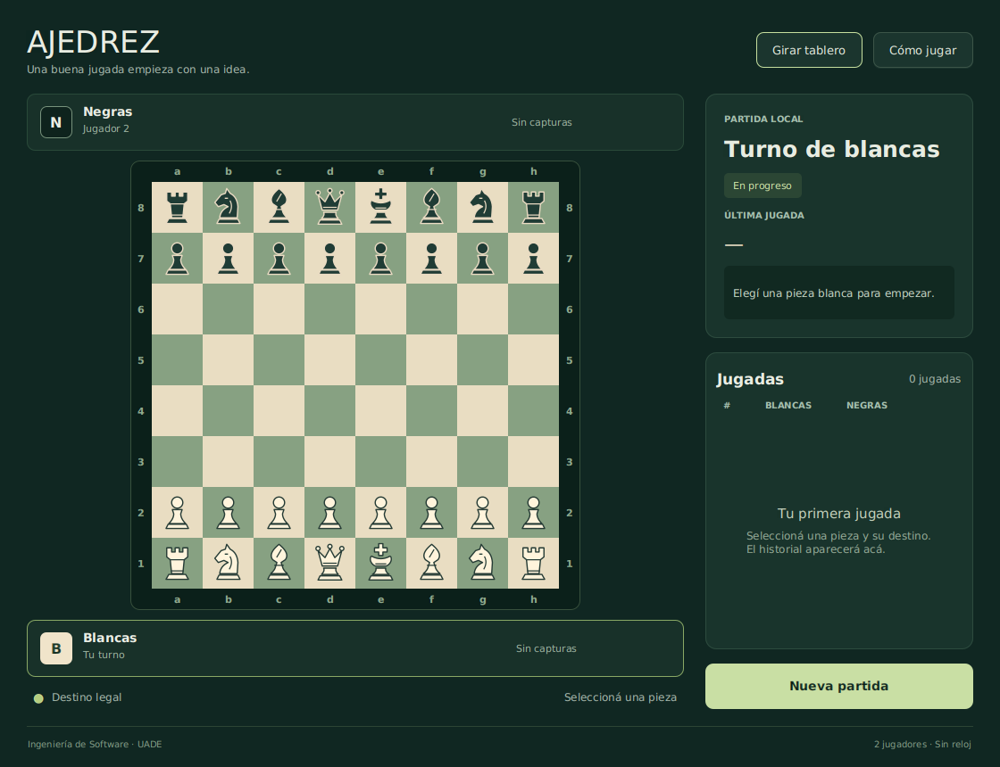

# Ajedrez · TPO Ingeniería de Software

Proyecto Java 17 con interfaz JavaFX para dos jugadores locales. Se agregó
un adaptador `gui/` al proyecto original. **Todos los archivos de `domain/`,
`application/` y `console/` se conservaron sin cambios.**



## Iniciar en Windows

1. Extraé **todo el ZIP** y entrá a la carpeta `chess-tpo`.
2. Tené instalado un **JDK 17 o superior**, accesible mediante `JAVA_HOME` o `PATH`.
3. Hacé doble clic en **`iniciar-gui.bat`**.

La primera ejecución necesita internet para descargar Maven y JavaFX. El
Maven Wrapper incluido evita instalar Maven por separado. Después se
reutilizan las dependencias descargadas.

También podés abrir PowerShell en esta carpeta y ejecutar:

```powershell
.\mvnw.cmd javafx:run
```

En macOS o Linux, con JDK instalado y entorno de escritorio:

```bash
chmod +x mvnw iniciar-gui.sh
./iniciar-gui.sh
```

Si ya tenés Maven, también funciona `mvn javafx:run`. No necesitás configurar
un SDK JavaFX manualmente: Maven descarga sus dependencias para tu sistema.

## Cómo jugar

- Seleccioná una pieza del jugador que tiene el turno y luego su destino.
- Los puntos indican destinos legales; los anillos indican capturas legales.
- Tocá otra pieza propia para cambiar la selección, o repetí la casilla para cancelarla.
- Los movimientos rechazados conservan el tablero, el turno y la selección.
- La última jugada queda resaltada. Las capturas aparecen en la barra del jugador que capturó.
- El panel muestra turno, jaque, última jugada e historial por pares de jugadas.
- `Girar tablero` cambia la orientación visual sin cambiar la partida.
- `Nueva partida` pide confirmación cuando ya hay jugadas y reinicia la partida completa.
- Atajos: `Esc` cancela; `Ctrl+F` gira; `Ctrl+N` inicia otra partida.
- Los botones también se pueden recorrer con `Tab` y activar con `Espacio`.

## Alcance de las reglas

La GUI utiliza las reglas existentes: tablero 8×8, seis tipos de piezas,
turnos, capturas, movimientos con bloqueos, jaque y prevención del autojaque.

**El backend original no implementa enroque, promoción, captura al paso,
jaque mate ni tablas. Esta actualización de frontend tampoco los agrega.**
Un aviso de jaque no declara un ganador. No se agregaron reloj, IA ni juego en red.

## Arquitectura

La consola y JavaFX son adaptadores distintos del mismo puerto `ChessGame`.
El dominio y la aplicación no importan JavaFX ni conocen componentes gráficos.

| Clase nueva | Responsabilidad |
| --- | --- |
| `ChessGuiApp` | Arranca JavaFX e inyecta la fábrica de partidas. |
| `ChessWindow` | Compone ventana, paneles, diálogos e historial. |
| `ChessController` | Mantiene selección e historial de presentación; delega jugadas a `ChessGame`. |
| `ChessViewState` | Expone una instantánea con listas inmutables. |
| `ChessBoardView` | Dibuja casillas, coordenadas y marcas; emite eventos. |
| `PieceRenderer` | Dibuja piezas mediante siluetas vectoriales propias y escalables. |
| `PresentationText` | Traduce colores, nombres de piezas y motivos de rechazo. |
| `MoveEntry` | Guarda una jugada aceptada para el historial y las capturas de la GUI. |
| `LegalMovePreview` | Consulta destinos mediante partidas temporales, usando solo `ChessGame`. |

### Destinos legales sin cambiar el backend

El contrato original no expone `getLegalMoves()`. Para cada destino candidato,
`LegalMovePreview` crea una partida independiente, reproduce las jugadas
aceptadas y llama a `move(origen, destino)`. Solo los resultados exitosos se
muestran como destinos legales. Esto incluye la validación de autojaque.

La consulta no modifica la partida visible, no accede a `Board` ni a
`MoveValidator` y no reimplementa reglas. La fábrica inyectada debe generar
una instancia nueva con el mismo estado inicial en cada llamada. El historial
de esta GUI parte siempre de una partida estándar nueva.

Esta solución preserva el backend. Su costo aumenta con la cantidad de
jugadas: recrea hasta 63 partidas por selección. Si más adelante se permite
evolucionar el puerto, una consulta de movimientos legales en la aplicación
permitiría reemplazar este componente sin cambiar el tablero gráfico.

## Consola, tests y empaquetado

La configuración original de consola se conserva:

```powershell
.\mvnw.cmd compile exec:java
```

Tests JUnit, incluidos los del adaptador, sin necesidad de abrir una ventana:

```powershell
.\mvnw.cmd test
```

Construir los JAR:

```powershell
.\mvnw.cmd package
```

El JAR con dependencias conserva **la consola** como entrada:

```powershell
java -jar target/chess-tpo-1.0.0-jar-with-dependencies.jar
```

Para la GUI usá `iniciar-gui.bat` o `javafx:run`; ese JAR no es su lanzador.
En Linux/macOS reemplazá `.\mvnw.cmd` por `./mvnw`.

## Cambios y verificación

- Se agregó `gui/`, una hoja de estilos y diez tests de integración del controller.
- `pom.xml` incorpora JavaFX 17.0.18, su plugin de ejecución y una versión explícita
  del plugin de compilación. La entrada de consola y su empaquetado se mantienen.
- Se agregaron Maven Wrapper, lanzadores, documentación y una captura de la GUI.
- Se compararon los 38 archivos Java originales contra el ZIP fuente: ninguno cambió.
- Maven ejecutó **49 tests, todos aprobados**: 39 existentes y 10 nuevos.
- Se comprobó la ventana con JavaFX en modo headless: selección, destinos, errores,
  turnos, historial, capturas, giro, confirmación de reinicio y aviso de jaque.
- Se revisaron capturas del estado inicial, selección, captura, giro, jaque y tamaño mínimo.

No se incluyen `target/` ni dependencias descargadas dentro del ZIP. Se generan
en tu máquina al compilar o ejecutar.
